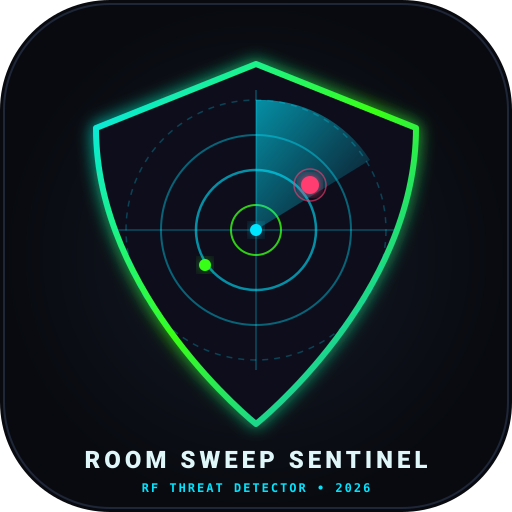

<p align="center">
  
</p>

# Room Sweep Sentinel (RF-Sweep)

Professional full-stack Electronic Countermeasures & Technical Surveillance Countermeasures (TSCM) application designed to locate covert audio bugs, pinhole spy cameras, rogue trackers, and hidden transmitters operating over Wi-Fi and Bluetooth Low Energy (BLE).

Engineered for **Android / Google Pixel** with **Material You 3.0 (2026 aesthetics)**, real-time asynchronous architecture, and strict compliance with the European **NIS 2 Directive** (EU 2022/2555).

---

## Key Features

- **360° Real-Time Radar Sweep**: 60 FPS hardware-accelerated animated radar canvas with green/cyan phosphor decay and concentric proximity range circles (1m, 3m, 5m, 10m).
- **Geiger Proximity Tracker (Hot/Cold)**: Audio and haptic pinpointing mode where click rate and vibration cadence accelerate as you physically approach the hidden transmitter (down to 50 cm accuracy).
- **Dual-Language Interface (🇮🇹 / 🇬🇧)**: One-tap flag switch in the app bar to toggle dynamically between Italian and English.
- **Heuristic Threat Detection Engine**:
  - Surveillance OUI chip matching (Espressif ESP32/ESP8266, Tuya IoT, Raspberry Pi, Axis, Hikvision, Dahua).
  - Rogue beacon localization (Apple AirTag / FindMy, Tile, Samsung SmartTag).
  - Covert network detection (Hidden SSIDs and spy camera patterns: `CAM-`, `IPCAM-`, `SPYCAM`, `HD-MINI`).
- **Predictive AI Telemetry Analysis**:
  - Time-series RSSI variance and transmission interval tracking.
  - Periodic burst detection (store-and-forward surveillance microphones).
- **NIS 2 Compliance & Tamper-Proof Audit Trail**:
  - Local-first forensic log with SHA-256 cryptographic chaining ($$\text{Hash}_n = \text{SHA-256}(\text{Record}_n \parallel \text{Hash}_{n-1})$$).
  - Zero cloud exfiltration of radiofrequency telemetry.
  - One-tap quick export to structured tables and sharing shortcuts (Email, WhatsApp, Drive).
- **Google Pixel & Play Protect Safe**:
  - Clean package identity: `com.francescocastaldi.roomsentinel`
  - Granular Android 12-16 permissions (`NEARBY_WIFI_DEVICES`, `BLUETOOTH_SCAN` with `neverForLocation` flag).
- **Automated CI/CD GitHub Actions**:
  - Automatic compilation of signed release APK on every git tag/push with downloadable artifact attachment.

---

## Repository Structure

```
room-sweep-sentinel/
├── assets/                   # Vector branding and logo assets
│   └── logo.svg
├── backend/                  # FastAPI async engine, WebSockets & Threat Predictor
│   ├── app/
│   │   ├── api/routes.py     # REST endpoints & /ws/live-stream
│   │   ├── models/device.py  # Pydantic schemas
│   │   ├── services/         # Threat engine, OUI database, Predictive AI
│   │   └── main.py
│   ├── tests/                # 32 automated pytest test cases (100% pass)
│   └── requirements.txt
├── mobile_app/               # Flutter Material You 3.0 Android App
│   ├── android/              # Play Protect-safe AndroidManifest.xml
│   ├── lib/
│   │   ├── models/           # RF device and audit models
│   │   ├── theme/            # AMOLED pure dark, neon cyan/amber palette
│   │   ├── services/         # Scanner, audit logger, and localization (IT/EN)
│   │   ├── widgets/          # 360° Radar canvas, Geiger sheet, Animated logo
│   │   └── screens/          # Sweep dashboard, Device list, NIS2 Audit report
│   ├── test/                 # Unit tests
│   └── pubspec.yaml
└── .github/workflows/        # Automated APK compilation workflow
```

---

## Quickstart

### Backend (Python 3.12+)
```bash
cd backend
python -m venv .venv
source .venv/bin/activate  # on Windows: .venv\Scripts\activate
pip install -r requirements.txt
python -m pytest tests/ -v
uvicorn app.main:app --host 0.0.0.0 --port 8000 --reload
```

### Mobile App (Flutter)
```bash
cd mobile_app
flutter pub get
flutter test
flutter run -d <google-pixel-device-id>
```

---

## License
MIT License - Copyright (c) 2026 Francesco Castaldi.